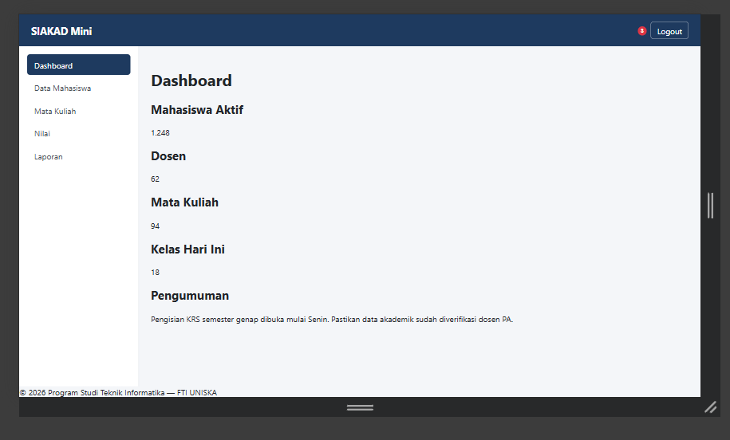
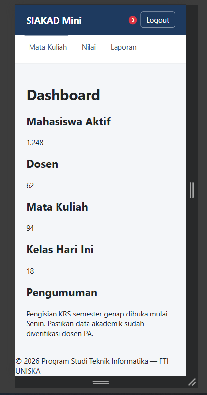

# Laporan Praktikum Pertemuan 5 — Pemrograman Web 1

Nama : Muhammad Azmi Azkia
NPM : 2510010458
Kelas : 3B Reg Pagi TI BJB

## Percobaan 1 — Box Model

| No | Kondisi | Lebar Kotak A (px) | Lebar Kotak B (px) |
|---|---|---:|---:|
| 1 | padding 20px | 350 px | 300 px |
| 2 | padding 40px | 390 px | 300 px |

| No | Kondisi | Jarak judul–paragraf (px) |
|---|---|---:|
| 3 | Block biasa | 30 px |
| 4 | Di dalam flex column | 50 px |

| No | Kondisi .menu a | Latar menimpa teks lain? (ya/tidak) |
|---|---|---|
| 5 | inline (bawaan) | Ya |
| 6 | inline-block | Tidak |

## Percobaan 2 — Flexbox Lab

| No | Properti dan nilai | Pengamatan |
|---|---|---|
| 1 | display: flex | Ketiga item tersusun horizontal dalam satu baris |
| 2 | justify-content: space-between | Item A berada di kiri, item C di kanan, dan item B berada di tengah dengan jarak yang terbagi merata |
| 3 | justify-content: space-evenly | Jarak antaritem dan jarak item terhadap tepi container sama rata |
| 4 | align-items: stretch vs center | Item memanjang mengikuti tinggi dan Item berada di tengah secara vertikal dengan tinggi|
| 5 | flex-direction: column + justify-content: center | Item tersusun vertikal dan berada di tengah container |
| 6 | 8 item x 200 px, nowrap vs wrap | Item tetap berada dalam satu baris dan ukurannya menyusut agar muat di dalam container vs Item yang tidak muat berpindah ke baris berikutnya dengan ukuran tetap |
| 7 | .b { flex-grow: 1 } | Item B mengambil seluruh ruang kosong, sedangkan A dan C tetap sesuai lebar |
| 8 | Lebar A/B/C(px) | Menjadi 0 px |
| 9 | .c { order: -1 } | Item C berpindah ke posisi pertama tanpa mengubah urutan HTML |
| 10 | .c { margin-left: auto } | Item C terdorong ke sisi kanan container, sedangkan A dan B tetap di kiri |
| 11 | gap: 24px | Terdapat jarak 24px di antara setiap item tanpa menambahkan jarak pada tepi container |

## Percobaan 3 — Positioning

| No | Eksperimen | Pengamatan |
|---|---|---|
| 1 | Header sticky saat digulir | Header mengikuti alur halaman dan menempel di bagian atas saat halaman digulir |
| 2 | Header fixed tanpa padding-top body | Header tetap berada di atas layar, tapi menutupi judul dan paragraf pertama |
| 3 | Header fixed dengan padding-top 64px | Konten halaman kembali terlihat karena diberi jarak untuk header |
| 4 | .notif tanpa position: relative | Badge notifikasi berpindah ke kanan atas header, bukan berada di dekat tombol lonceng |
| 5 | .lapis-1 z-index 3, lalu .lapis-2 z-index 5 | Elemen lapis 1 tampil di depan elemen yang memiliki nilai z-index lebih rendah lalu Elemen lapis 2 tampil paling depan karena memiliki nilai z-index lebih tinggi |
| 6 | Header z-index 1 | Elemen lapis 1 dan 2 menutupi header ketika saling bertumpuk, sedangkan header tetap berada di depan elemen lapis 3 yang tidak diposisikan |
| 7 | Tombol Bantuan di layar 375 px| Tombol bantuan tetap berada di kanan bawah layar meskipun halaman digulir |

## Percobaan 4 — Dashboard

## Jawaban Pertanyaan Analisis

1. Karena border-box membuat ukuran elemen lebih mudah diprediksi. Lebar dan tinggi yang ditentukan sudah mencakup padding dan border, sehingga tidak perlu menghitung tambahan ukuran secara terpisah.

2. Ketika flex-direction: column digunakan, main axis berubah menjadi vertikal dan cross axis menjadi horizontal. Oleh karena itu, justify-content: center mengatur item agar berada di tengah sepanjang arah vertikal.

3. Lebar container adalah 1000 px. Item A memiliki lebar tetap 200 px, sehingga ruang tersisa adalah 800 px. Ruang tersebut dibagi berdasarkan perbandingan flex: 1 pada B dan flex: 2 pada C.
- B = 800 × 1/3 = 266,7 px
- C = 800 × 2/3 = 533,3 px
Jika .b menggunakan flex: 1 1 auto, nilai flex-basis menjadi auto, sehingga ukuran awal B berdasarkan ukuran kontennya. Akibatnya, pembagian ruang tidak lagi sesederhana perbandingan 1:2 karena ukuran awal item ikut diperhitungkan.

4.  Karena elemen .notif menggunakan position: relative sebagai titik acuan badge yang memiliki position: absolute. Dengan demikian, badge diposisikan relatif terhadap .notif, bukan terhadap halaman atau header secara keseluruhan.

5. Sticky membuat navbar tetap berada di posisi normal terlebih dahulu, kemudian menempel di bagian atas saat halaman digulir. Sementara itu, fixed membuat navbar selalu berada pada posisi tertentu di layar dan keluar dari alur dokumen. Saya memilih sticky karena navbar tetap mengikuti alur halaman dan dapat menempel di bagian atas saat pengguna melakukan scrolling.

6. flex: 1 membuat .wrapper mengambil ruang yang tersedia dalam container Flexbox. Jika deklarasi tersebut dihapus, .wrapper tidak lagi otomatis mengisi seluruh ruang sisa, sehingga area konten dashboard dapat menjadi lebih sempit atau tidak memenuhi tinggi halaman sesuai rancangan.

## Kesimpulann

Melalui praktikum ini, saya mempelajari penggunaan CSS Box Model, Flexbox, dan Positioning untuk mengatur tata letak halaman web. Lalu memahami fungsi box-sizing, pengaturan posisi elemen, serta pembuatan dashboard yang responsif menggunakan Flexbox. Kendala yang saya hadapi adalah aagak kesulitan memahami beberapa properti CSS dan menyesuaikan tampilan dashboard pada ukuran layar yang berbeda.