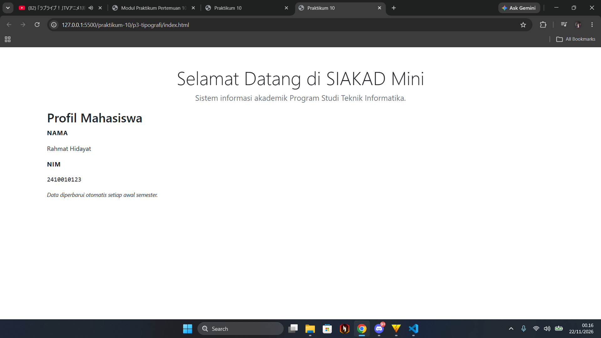
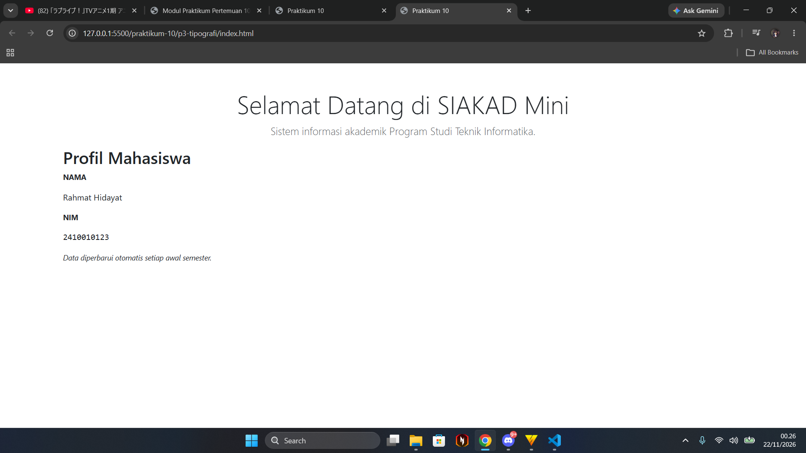

# Laporan Praktikum Pertemuan 10 — Pemrograman Web 1

Nama : Muhammad Azmi Azkia
NPM  : 2510010458
Kelas: 3B Reg Pagi TI BJB

## Percobaan 1 — Navbar Lab

| No. | Eksperimen | Pengamatan |
|---|---|---|
| 1 | Class #menuLab dan aria-expanded | Saat menu terbuka, class menjadi collapse show dan aria-expanded bernilai true. |
| 2 | Hamburger di 1000 px | Hamburger tidak tampil karena breakpoint navbar-expand-lg adalah 992 px. |
| 3 | Perilaku di 800 px | -md menampilkan menu horizontal, tanpa sufiks selalu horizontal, tanpa expand selalu terlipat. |
| 4 | data-bs-target salah ketik | Menu tidak terbuka karena target tidak sesuai dengan ID elemen. |
| 5 | Tanpa JS bundle | Hamburger dan dropdown tidak berfungsi. |
| 6 | bg-dark tanpa dan dengan data-bs-theme | Tanpa tema gelap teks sulit dibaca, sedangkan dengan tema gelap teks menjadi terang. |
| 7 | sticky-top vs fixed-top | sticky-top tidak menutupi konten, sedangkan fixed-top dapat menutupi judul. |

## Percobaan 2 — Buttons & Badges

| No. | Eksperimen | Pengamatan |
|---|---|---|
| 1 | Kelompok Batal–Simpan di 375 px dan 1000 px | Pada 375 px tombol bertumpuk, sedangkan pada 1000 px tombol berjajar dan rata kanan. |
| 2 | Elemen nonaktif yang masih bisa difokus | Button disabled dilewati Tab, sedangkan link disabled yang masih memiliki href tetap bisa difokus dan diaktifkan. |
| 3 | Kontras text-bg-warning vs bg-warning | text-bg-warning lebih mudah dibaca karena menggunakan teks gelap, sedangkan bg-warning menggunakan teks putih. |
| 4 | Nama tombol Notifikasi | Dengan visually-hidden terbaca Notifikasi 3 notifikasi belum dibaca, tanpa visually-hidden hanya Notifikasi 3. |

## Percobaan 3 — Tipografi

| Class lama | Utilitas pengganti | Tampilan sama? |
|---|---|---|
| .judul-besar | display-5 text-center | Ya, hampir sama |
| .pembuka | lead text-body-secondary text-center | Ya, hampir sama |
| .label | text-uppercase fw-bold small | Ya, hampir sama |
| .catatan | small fst-italic | Ya |
| .nim | font-monospace | Ya |
| Temuan Lighthouse untuk h4 | Heading tidak berurutan menurun karena h1 langsung ke h4. Solusi menggunakan h2 class="h4". | Struktur diperbaiki |

### Dokumentasi Percobaan 3

## Kesimpulan

Berdasarkan praktikum pertemuan 10, Bootstrap menyediakan berbagai komponen untuk membuat tampilan website lebih responsif dan terstruktur. Navbar dapat menyesuaikan tampilan berdasarkan ukuran layar. Buttons dan badges membantu membedakan fungsi serta status suatu informasi. Utilitas tipografi dapat menggantikan CSS manual sehingga kode menjadi lebih sederhana dan mudah dikelola.
